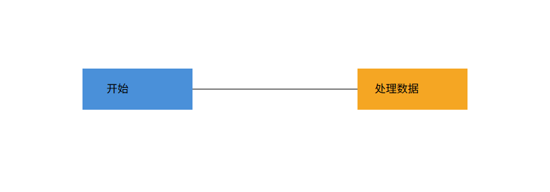

# SVG CLI Editor

PJ1 Phase 1 作业：一个用 TypeScript 编写的、面向对象的命令行 SVG 编辑器。程序通过 `svg>` REPL 完成 SVG 文档的创建、读取、保存，以及基础图形的创建、移动、缩放、分组、删除、属性修改、结构查看和撤销重做。



## 快速开始

要求 Node.js 20 及以上。

```bash
npm install
npm run cli
```

启动后输入 `help` 查看全部命令：

```text
svg-editor 0.1 — type 'help' for commands

svg> init 800 600
canvas 800x600 created
svg> create rect r1 120 100 160 60 #4a90d9
rect#r1 created
svg> save demo.svg
saved to demo.svg (1 elements)
```

把 `examples/flowchart.session` 中的命令通过标准输入喂给 CLI，可以重放完整示例：

```powershell
Get-Content examples/flowchart.session -Encoding UTF8 | npm run cli
```

PowerShell 的管道编码可能影响中文，Windows 上也可以直接逐行粘贴脚本中的命令。生成结果见 [`examples/flowchart.svg`](examples/flowchart.svg)。

## 常用命令

| 类别 | 命令 |
|---|---|
| 文档 | `init [w] [h]`、`read <file.svg>`、`save [file.svg]`、`canvas [w] [h]` |
| 图形 | `create <type> <id> [params…] [in <gid>]`、`delete`、`move`、`scale`、`set` |
| 结构 | `group`、`ungroup`、`addto`、`front`、`back`、`tree [id]`、`show <id>` |
| 历史 | `undo`、`redo` |

内置类型：`rect`、`circle`、`ellipse`、`line`、`text`、`g`。`box` 属于后续插件化阶段，本阶段按规范返回 `unknown shape type`。

`#` 开头的行是注释；含空格的参数用双引号包裹。文档类命令（`init` / `read` / `save` / `canvas` 改尺寸）会开启新的撤销纪元，直到下一次编辑命令。

## 质量检查

```bash
npm run check        # typecheck + 架构依赖检查 + 59 个测试
npm run test:coverage
npm run build
npm start            # 运行编译后的 dist/cli/main.js
```

架构、设计模式、AI 协作过程、一致性自查和功能完整性说明见 **[doc/README.md](doc/README.md)**。

## 目录

```text
src/
  domain/         实体、组合结构、命令、Memento、形状工厂
  application/    解析、分发、会话、命令处理器、显示、网关端口
  infrastructure/ SVG 读写适配器
  cli/            REPL 和组合根
  shared/         错误与数值格式化
doc/              架构与过程文档、PlantUML、截图
examples/         可重放的会话脚本与示例 SVG
tests/            单元、集成、IO 和 CLI 测试
scripts/          架构规则检查
```
