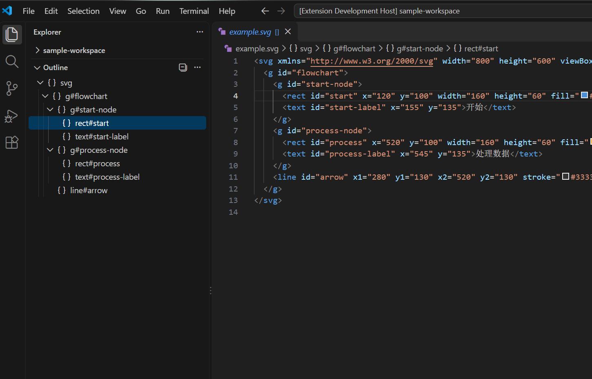
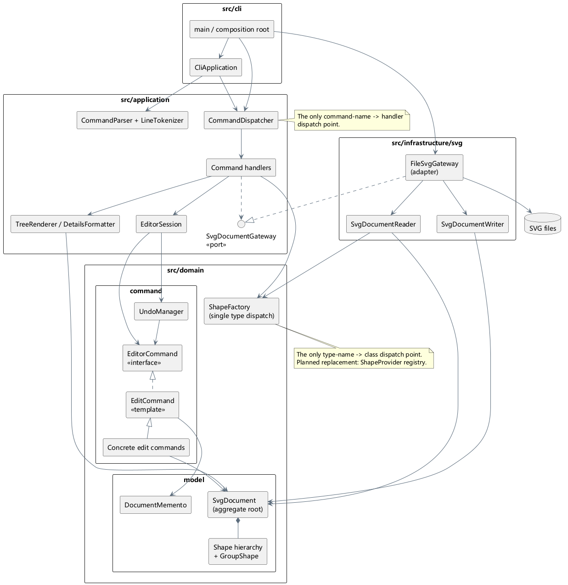
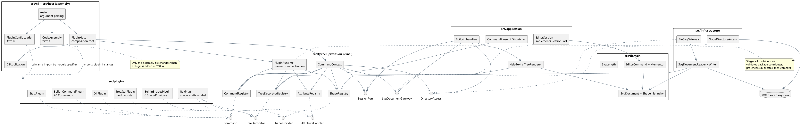

# PJ1 Phase 2：插件实践与插件式重构

代码仓库：<https://github.com/1745145831-ops/svg-cli-editor>。Phase 1 的收尾标签是 `final`，Phase 2 的收尾标签是 `p2`。

这次作业分两件事：先写一个 VS Code 扩展，再回头把 Phase 1 的 CLI 改成可插拔的结构。扩展已经能实际运行，CLI 的原有命令和六种图形也做了回归对照。下面记录实现方式、几个需要取舍的地方，以及最后跑过的验证。




## 1. 怎么运行

环境是 Node.js 20 以上。

```bash
npm install
npm run build:cli
npm run cli                  # 源码模式，方式 A
npm start                    # 编译后的 CLI，方式 A
npm start -- --config plugins.config.json   # 方式 B
```

默认装配会加载 `stats`、`dir`、`box` 和 `modified-star`。如果只想看 Phase 1 的行为：

```bash
npm start -- --config plugins.phase1.json
```

VS Code 扩展单独构建和启动：

```bash
npm run build:vscode
code --extensionDevelopmentPath=<repo>/vscode-extension <repo>/vscode-extension/sample-workspace
```

打开 `sample-workspace/example.svg` 的文本编辑器，再打开 Explorer 和 Outline。示例目录里放了 `notes.txt`、`docs/` 和缺少闭合标签的 `broken.svg`，方便对照“哪些文件有标记”和“坏 XML 会不会让扩展崩掉”。

## 2. VS Code 扩展

### 2.1 文件标记

文件标记在 [`vscode-extension/src/svgBadgeProvider.ts`](../vscode-extension/src/svgBadgeProvider.ts)。`SvgBadgeProvider` 实现 `FileDecorationProvider`，先判断 URI 是不是本地 `.svg` 路径，再用 `workspace.fs.stat` 确认它确实是文件。后面这一步是为了排除名字以 `.svg` 结尾的目录。返回的 `FileDecoration` 只有 `badge: "[]"`、tooltip 和颜色，没有改动文件名或文件内容。


截图里 `broken.svg` 和 `example.svg` 右侧有 `[]`，`notes.txt` 和 `docs/` 没有标记，文件名也没有变化。

### 2.2 原生大纲

Outline 部分由两个类完成：

- [`outlineParser.ts`](../vscode-extension/src/outlineParser.ts) 是一个带源码位置的轻量 XML 解析器。它只解析标签和 `id`，记录 `start`、`nameStart`、`nameEnd`、`end`，跳过注释、CDATA 和处理指令，不完整的标签会停在当前位置。
- [`svgOutlineProvider.ts`](../vscode-extension/src/svgOutlineProvider.ts) 把解析结果转成 `DocumentSymbol`。节点名是 `tag#id`，没有 id 时就是 `tag`；`selectionRange` 覆盖标签名，`range` 覆盖整个元素，所以点击节点会跳到对应的开始标签。

注册在 [`extension.ts`](../vscode-extension/src/extension.ts) 的 `activate()` 里：

```ts
vscode.window.registerFileDecorationProvider(new SvgBadgeProvider())
vscode.languages.registerDocumentSymbolProvider(
  [{ language: "xml", pattern: "**/*.svg" }],
  new SvgOutlineProvider()
)
```

VS Code 负责在需要时调用这两个 provider，编辑后会重新请求符号，扩展本身不需要监听文本变化。截图里选中的是 `rect#start`，编辑器的光标落在第 4 行；无 id 的 `text` 节点只显示 `text`。

测试在 [`tests/vscode/outline-parser.test.ts`](../tests/vscode/outline-parser.test.ts)，覆盖嵌套分组、无 id、编辑后的层级变化、未闭合 XML、错误闭合、注释里的伪标签，以及属性值中出现 `>` 的情况。

### 2.3 VS Code 和扩展各自做什么

VS Code 负责扩展宿主、激活时机、provider 的注册表、Explorer 和 Outline 的渲染、编辑事件和源码跳转。扩展只做三件事：判断 URI 是否该加标记、把文本文档解析成轮廓、调用 VS Code 的注册 API。文件内容始终由 VS Code 的文本模型持有，扩展不写文件。

调用关系可以写成：

```text
VS Code 启动
  -> 加载 dist/extension.js
  -> activate(context)
  -> 注册 SvgBadgeProvider 和 SvgOutlineProvider
  -> 需要装饰时调用 provideFileDecoration(uri)
  -> 需要大纲时调用 provideDocumentSymbols(document)
  -> VS Code 渲染 badge 和 Outline 树
  -> 点击节点时用 DocumentSymbol.selectionRange 定位
```

### 2.4 文件装饰和 Decorator、Adapter 的关系

文件装饰和 GoF 的 Decorator 有相同的意图：不修改原对象，只在外面附加信息。但结构不一样。经典 Decorator 实现同一个接口并持有被装饰对象，调用会继续转发，装饰器可以一层层叠加。这里的 `FileDecoration` 是 VS Code 渲染用的数据对象，`SvgBadgeProvider` 没有被包装的 `Uri`，也没有转发链。把它叫“展示层 provider”更准确。

和 Adapter 的关系更直接一些。`SvgBadgeProvider` 适配的是 VS Code 的 `FileDecorationProvider` 接口，`SvgOutlineProvider` 把轮廓节点树转成 `DocumentSymbol`。区别在于 Adapter 通常只做接口转换，这里还多了一步“从 URI 或文本文档生成新数据”。`SvgOutlineProvider` 内部组合了 `SvgOutlineParser`，没有用继承。

### 2.5 Phase 1 的解析和模型能不能复用

XML 读取和 `Shape` 模型不适合直接拿到编辑器里用。`SvgDocumentReader` 依赖 Node 的 `fs`，一次读整个文件，遇到不完整 XML 或未知元素会抛错；它生成的 `Shape` 树也没有源码位置，Outline 没法用它定位。`LineTokenizer` 只处理 REPL 的双引号，不能拿来解析 XML。`SvgLength`、`NumberFormat` 在概念上有复用价值，但扩展只显示标签和层级，引入它们反而增加依赖。

真正复用的是一些思路：按文档顺序深度优先遍历、容器和叶子的区分、标签命名规则。实现上还是另写了带 position 的解析器。这样扩展可以独立打包，也能在 XML 不完整时继续给出部分结果。

## 3. CLI 的插件框架

### 3.1 目录和依赖方向

```text
src/
  kernel/                 扩展点接口、注册表、事务激活、端口、命令上下文
  domain/                 图形模型、组合树、命令、Memento、长度归一化
  application/            解析、分发、会话、内置 handler、显示
  infrastructure/         SVG 读写和目录访问适配器
  plugins/
    builtin-shapes/       六种图形 provider
    builtin-commands/     Phase 1 的 20 条命令
    stats/                stats 命令
    dir/                  dir 命令
    shape-box/            box 图形、属性处理器、(box) 标签
    tree-star/            modified-star 标签
  host/                   组合根、代码装配、配置加载器
  cli/                    入口和终端适配器
plugins/                  配置装配使用的 package（package.json + dist 转发）
vscode-extension/         独立的 VS Code 扩展
```

内核只依赖 `domain` 和 `shared`。`application` 和 `infrastructure` 依赖内核端口，可选插件只接触 kernel 和 domain，`host` 是唯一同时知道具体实现和基础设施的地方。依赖方向由 [`scripts/check-architecture.mjs`](../scripts/check-architecture.mjs) 检查。

重构前，图形类型靠 `ShapeFactory` 里的 `switch`，命令名靠 `CommandDispatcher` 构造时的一张表。现在换成两个注册表：`ShapeRegistry` 按 `shapeType` 找 provider，按 tag 和匹配规则解析 SVG；`CommandRegistry` 按命令名或别名找 `Command`。内核里没有 `type === "box"` 或 `command === "stats"` 这样的分支。

### 3.2 四个扩展点

先把四个扩展点放在一张表里，后面再分别说细节。

| 扩展点 / 接口 | 职责 | 内核调用位置 | 已有实现 | 关掉本阶段可选插件时 | 违反契约时 |
|---|---|---|---|---|---|
| `ShapeProvider` | 一种图形的 CLI 创建与 SVG 读回 | `ShapeRegistry.createFromCli` 由 `CreateCommandHandler.execute` 调用；`resolveSvg/createFromSvg` 由 `SvgDocumentReader.convertElement` 调用 | 六个内置 provider；`BoxShapeProvider` | 六种内置图形保留；`create box` 报 `unknown shape type`；`data-kind=box` 读成普通组 | 重名 `duplicate registration: shapes/<name>`；创建异常回滚命令，读入异常包成 `cannot parse SVG` 且不换文档 |
| `Command` | 一条 REPL 命令的名称、别名、帮助和执行逻辑 | `CommandRegistry.execute` 由 `CommandDispatcher.dispatch` 调用，入口是 `CliApplication.handleLine` | `BuiltinCommandPlugin`；`StatsCommand`；`DirCommand` | 只保留 Phase 1 命令表；`stats`/`dir` 报 `unknown command`；`help` 不变 | 重名 `duplicate registration: commands/<name>`；未知命令由 registry 报错；命令异常由 CLI 加 `error:`，进程不退出 |
| `TreeDecorator` | 给 `tree` 的某一行追加行尾标签 | `TreeDecoratorRegistry.decorationsFor` 由 `TreeRenderer.withLabels` 调用 | `BoxTypeDecorator`；`ModifiedStarDecorator` | 没有标签，`tree` 与 Phase 1 逐字节一致 | 重名 `duplicate registration: decorators/<name>`；标签异常作为命令错误显示，不影响下一条命令 |
| `AttributeHandler` | 定义某个图形上某个属性的领域语义 | `AttributeRegistry.apply` 在 `SetAttributeCommand.apply` 中调用，命令入口是 `SetCommandHandler.execute` | `BoxAttributeHandler` | 无处理器命中时回到 `Shape.setAttribute` 白名单规则 | 重名 `duplicate registration: attributes/<name>`；同优先级冲突报 `ambiguous attribute handlers`；处理器异常由 `EditCommand` 恢复快照，历史不增加 |

#### ShapeProvider

接口在 [`src/kernel/plugin/ShapeProvider.ts`](../src/kernel/plugin/ShapeProvider.ts)，负责一种图形从 CLI 参数创建、从 SVG 元素读回，并声明 tag、是否为容器、SVG 匹配规则和帮助行。

`ShapeRegistry` 的 `createFromCli()` 被 [`CreateCommandHandler.execute`](../src/application/handlers/CreateCommandHandler.ts) 调用；`resolveSvg()` 和 `createFromSvg()` 被 [`SvgDocumentReader.convertElement`](../src/infrastructure/svg/SvgDocumentReader.ts) 调用。

已有的实现是 `BuiltinShapesPlugin` 里的 rect、circle、ellipse、line、text、g 六个 provider，以及 `BoxShapeProvider`。不加载可选插件时，这六种图形仍默认存在；`create box` 会报 `unknown shape type: box (is the plugin loaded?)`；读取带 `data-kind="box"` 的 `<g>` 时由优先级更低的 g provider 当成普通组读入。

注册名重复会抛 `duplicate registration: shapes/<name>`。provider 在创建时抛错，命令会走 `EditCommand` 的 before 快照恢复，历史不增加；在读入时抛错，reader 会包成 `cannot parse SVG: ...`，当前文档保持不变。

#### Command

接口在 [`src/kernel/plugin/Command.ts`](../src/kernel/plugin/Command.ts)，包含命令名、别名、usage、summary 和执行方法。`CommandRegistry.execute()` 由 [`CommandDispatcher.dispatch`](../src/application/CommandDispatcher.ts) 调用，最后进入 [`CliApplication.handleLine`](../src/cli/CliApplication.ts)。

内置命令由 `BuiltinCommandPlugin` 注册；`stats` 和 `dir` 分别在各自的插件包里。不加载它们时，执行对应命令会得到 `unknown command: stats (type 'help')`，`help` 的内容和 Phase 1 一样。命令名或别名重复会报 `duplicate registration: commands/<name>`；命令抛出的错误由 CLI 统一加上 `error:`，不会让进程退出。

#### TreeDecorator

接口在 [`src/kernel/plugin/TreeDecorator.ts`](../src/kernel/plugin/TreeDecorator.ts)，只负责给 `tree` 的某一行返回一个行尾标签。`TreeDecoratorRegistry.decorationsFor(row)` 收集所有标签，[`TreeRenderer.withLabels`](../src/application/display/TreeRenderer.ts) 负责拼接到行尾。

已有实现是 box 插件里的 `BoxTypeDecorator`（`(box)`）和 `modified-star` 的 `ModifiedStarDecorator`。没有 decorator 时，`tree` 输出与 Phase 1 逐字节一致，这一点在兼容性 transcript 里能直接比对。注册名重复会报 `duplicate registration: decorators/<name>`。单个 decorator 抛错会作为命令错误显示，不影响后续命令。

#### AttributeHandler

接口在 [`src/kernel/plugin/AttributeHandler.ts`](../src/kernel/plugin/AttributeHandler.ts)，`handles` 判断是否负责某个图形的某个属性，`apply` 执行修改。请求对象带 `document`、`shape`、`attribute`、`value`，所以处理器不用自己再查一遍文档，也不接触图形私有字段。

调用点在 `SetCommandHandler.execute`：它构造 `SetAttributeCommand` 时注入一个 override，实际执行在 [`SetAttributeCommand.apply`](../src/domain/command/SetAttributeCommand.ts)。已有实现是 `BoxAttributeHandler`，把 box 的 `fill` 转到内部 rect，把 `label` 转到内部 text。

没有处理器命中时，回退到 Phase 1 的 `Shape.setAttribute` 白名单规则。普通矩形的 `fill` 不需要插件也能改，未定义属性仍然报 `unknown attribute`。多个处理器同时命中时，按 `priority` 从高到低选；最高优先级相同就报 `ambiguous attribute handlers for <id>/<attr>`，不按注册顺序偷偷覆盖。处理器在 `apply` 中抛错时不会再走默认逻辑，`EditCommand` 会用 before 快照恢复文档，`EditorSession` 不记录这条命令。

### 3.3 重构前后的依赖图

Phase 1 的图保留在 [`architecture.puml`](architecture.puml)：



Phase 2 的图在 [`architecture-phase2.puml`](architecture-phase2.puml)：



图里刻意把 kernel、application、domain、infrastructure、plugins、host 分开画。新增插件时，改动集中在 plugins 和 host 的装配位置；application 和 domain 不需要知道插件名称。

## 4. 两种装载方式

### 4.1 方式的区别

方式 A 改代码。[`CodeAssembly.ts`](../src/host/CodeAssembly.ts) 里维护插件实例数组：

```ts
export const codeAssembly: readonly Plugin[] = [
  statsPlugin,
  dirPlugin,
  boxPlugin,
  treeStarPlugin
];
```

`main.ts` 在没有 `--config` 时依次调用 `host.activate(plugin)`。加插件就是加 import 和数组元素。

方式 B 改配置。仓库根目录的 [`plugins.config.json`](../plugins.config.json) 长这样：

```json
{
  "plugins": [
    { "module": "./plugins/stats" },
    { "module": "./plugins/dir" },
    { "module": "./plugins/shape-box" },
    { "module": "./plugins/tree-star" }
  ]
}
```

`module` 必填，相对路径以配置文件所在目录为基准，包名按 Node 的模块解析规则处理。`enabled: false` 会完全跳过，不 import 模块。`options` 是可选对象，会在 `activate` 之前传给插件的 `configure(options)`。

配置里的 `./plugins/stats` 是一个薄 package：`package.json` 写 `contributes` 和 `main`，`index.js` 只转发到 `dist/plugins/stats/index.js`。这样配置里用稳定的模块名，源码或编译产物由 package 自己处理。运行方式 B 之前需要先执行 `npm run build:cli`。

### 4.2 加载器

加载器在 [`src/host/loader/PluginConfigLoader.ts`](../src/host/loader/PluginConfigLoader.ts)，不属于内核。它只做模块解析、动态 import、读取 package.json 的 `contributes`，然后把插件交给 `PluginRuntime.activate`。文件里没有具体插件的导入，也没有 `switch (name)` 之类的分支。

四类失败的处理：

| 情况 | 输出 |
|---|---|
| 模块不存在 | `plugin not found: <module>` |
| 没有默认导出 | `plugin has no default export: <module>` |
| `contributes` 和实际注册不一致 | `plugin manifest mismatch: <name> (declared: …; registered: …)` |
| `activate` 抛错 | `plugin failed to activate: <name> (<reason>)` |
| 名称重复 | `duplicate registration: <category>/<name>` |

表里是 loader 返回的正文，入口会统一加上 `error: ` 前缀，例如 `error: plugin not found: ./plugins/x`。配置语法或结构不合法时同样输出 `error: invalid plugin config`，然后继续用默认内置能力启动。模块存在但求值失败会走激活失败，不会误报成模块不存在。这些错误都在加载阶段处理，主程序不会退出。

`PluginRuntime.activate` 先给每个插件建一个独立的 `PluginActivationContext`，插件激活期间只写入暂存数组。接着比较 package.json 的声明和实际注册集合，再对四类注册统一检查重名，全部通过后才提交。任何一步失败，当前插件的暂存内容全部丢弃，之前成功加载的插件保留。

### 4.3 双装配和 Phase 1 兼容性

[`scripts/verify-assembly.mjs`](../scripts/verify-assembly.mjs) 用同一个输入文件，在两个内容一致的固定临时目录里分别跑方式 A 和方式 B。日志写在目录外，`dir` 看到的初始文件相同，保存目标在两次运行之间删除。

```bash
npm run build:cli
npm run verify:assembly
# A/B identical: 1693 bytes, 46 lines
```

输出保存在 [`cli-2-code.txt`](transcript/cli-2-code.txt) 和 [`cli-2-config.txt`](transcript/cli-2-config.txt)，两份逐字节相同。输入文件只有命令和注释，没有 `svg>` 提示符或示例输出。

Phase 1 的对照使用 [`cli-1.txt`](transcript/cli-1.txt)。[`cli-1-final.txt`](transcript/cli-1-final.txt) 是从 `final` 标签的干净 worktree 构建出的 Phase 1 程序的输出；当前代码用空的 `plugins.phase1.json` 运行同一输入，结果写到 [`cli-1-phase2-builtins.txt`](transcript/cli-1-phase2-builtins.txt)。

```bash
npm run verify:compat
# Phase 1 compatibility identical: 1186 bytes
```

`box` 的两次提交也在历史里分开了：方式 A 的提交只改 `src/host/CodeAssembly.ts` 并新增 box 插件和测试；方式 B 的提交只改 `plugins.config.json`。两次提交中内核、加载器和已有插件的 diff 都为空。

## 5. stats 和 dir

### 5.1 stats

`stats` 在 [`src/plugins/stats/`](../src/plugins/stats/)，和内置命令表不在同一个包。它从画布子节点深度优先遍历，叶子按 `typeName` 首次出现的顺序计数，普通 `g` 和 `box` 只算容器，根 SVG 不算。空文档输出 `(total 0, containers 0)`。

命令只读文档，不调用 `executeEdit`，所以不进入 undo 栈。测试在 [`tests/plugins/stats.test.ts`](../tests/plugins/stats.test.ts)。

### 5.2 dir 和目录适配器

`dir` 在 [`src/plugins/dir/`](../src/plugins/dir/)，命令类不 import `fs`。目录访问的接口是 [`DirectoryAccess`](../src/kernel/ports/DirectoryAccess.ts)，实现是 [`NodeDirectoryAccess`](../src/infrastructure/fs/NodeDirectoryAccess.ts)。

对应到适配器模式：

- `DirCommand` 是 Client，只依赖目标接口；
- `DirectoryAccess` 是 Target，定义 `list(path)`；
- `NodeDirectoryAccess` 是 Adapter，把 `fs.readdirSync` 的 `Dirent` 转成 `DirectoryEntry`；
- `fs.readdirSync` 是被适配的已有接口。

测试里用 `FakeDirectoryAccess` 替换真实文件系统，覆盖混合目录、隐藏项、空目录和读取失败；另有一个测试使用临时目录和真实适配器。[`tests/plugins/dir.test.ts`](../tests/plugins/dir.test.ts) 还检查了未初始化文档时 `dir` 可用，以及执行后 undo 栈不增加。

输出规则是目录在前、文件在后，组内按名称升序；隐藏项保留，`.` 和 `..` 不列；符号链接等特殊项显示 `[OTHER]`，不遍历链接目标。读取失败时错误是 `cannot read directory: <path>`。

## 6. box

box 的实现都在 [`src/plugins/shape-box/`](../src/plugins/shape-box/)。`BoxShape` 继承 `GroupShape`，这样原有的组合树、递归 move/scale、Memento 和 id 索引都能直接用。

创建时生成两个子部件：`<id>-rect` 和 `<id>-label`。文本相对矩形偏移 `(+20,+35)`。序列化时 `<g>` 上写 `data-kind="box"`，填充色写在内部 rect 上。`set n1 fill red` 修改内部矩形，`set n1 label "开始"` 修改内部文本；这两条都通过 `BoxAttributeHandler`，内核的 `set` 里没有 box 分支。

创建前会检查整个新子树的 id。`SvgDocument.attach` 在挂载前递归调用 `assertSubtreeIdsFree`，所以 `n1-rect` 已经存在时，整条 `create box n1 ...` 失败，不会留下容器。

读入分两种情况。没有安装 box 插件时，`data-kind="box"` 的 `<g>` 由普通 g provider 读成 group，`data-kind` 作为保留属性写回，属于降级。安装了插件但子部件不满足“一个 rect + 一个 text”，或者 id 不符合 `<id>-rect` / `<id>-label`，reader 会拒绝整个读入，当前文档不变。重复 id 在分配 id 阶段就会拒绝，降级处理不了。

box 的两个必需子部件在构造时调用了 `lockStructure()`。普通 `delete n1-rect` 或 `addto other n1-label` 会被 `SvgDocument.remove/move` 拒绝；`ungroup n1` 由 `allowsUngroup = false` 拒绝。删除整个 box、或者在 box 内部继续嵌套其他容器，仍然可用。

测试在 [`tests/plugins/box.test.ts`](../tests/plugins/box.test.ts)，覆盖创建、嵌套、in 子句、整体 move/scale、属性修改和 undo/redo、必需子部件保护、子树 id 冲突、读写 round-trip、无插件降级、缺部件和错误 id 的读入、属性处理器部分修改后抛错的回滚、同优先级冲突，以及 stats 对 box 的计数。

## 7. 树标签

`(box)` 由 `BoxTypeDecorator` 提供，`modified-star` 由 `ModifiedStarDecorator` 提供。两个标签互相不知道对方，`TreeRenderer` 按注册顺序把非空标签拼到行尾。

`modified-star` 的规则：

- 基线是最近一次成功 `save` 或 `load` 时的文档内容；
- 叶子修改后只标叶子，不向祖先传播；容器自身属性或直接子节点结构变化才标容器；根 `svg` 比较整篇文档，所以有修改就标；
- 新建节点立即标 `*`，因为它不在基线里；
- 保存后 `*` 消失；保存后修改再 `undo` 回保存点，`*` 也消失；`redo` 后重新出现；
- 保存失败不会触发 `saved` 事件，基线不变。

状态都放在 decorator 实例的字段里，没有模块级变量。测试在 [`tests/plugins/tree-star.test.ts`](../tests/plugins/tree-star.test.ts)，包括两个实例互不影响。

CLI 里的效果：

```text
svg (800x600) *
└── g#n1 (box) *
    ├── rect#n1-rect   x=520 y=100 w=160 h=60 fill=#f5a623 *
    └── text#n1-label  (540,135) "处理数据 v2" *
```

## 8. 设计取舍

### ADR-001：属性处理器怎么拿到图形，多个处理器怎么处理

原来的接口只有 `shapeId`，处理器要自己查文档，也不清楚多个处理器同时命中时怎么办。现在请求对象直接带 `document` 和 `shape`，处理器通过图形的公开方法修改子部件。box 的 `setFill` / `setLabel` 就是这样暴露的，rect 和 text 字段仍然是私有的。

冲突规则选的是优先级：数值大的先选，最高优先级相同就拒绝。没有选“全部执行”是因为多个处理器各改一部分时，顺序会影响结果；也没有选“注册顺序覆盖”，因为那会让配置数组的顺序变成隐藏语义。

撤销和回滚沿用 `SetAttributeCommand` 已有的 Memento 事务。一次 `set` 只对应一个 `EditorCommand`，即使处理器改了 box 的两个子部件，`undo` 也只恢复一次。处理器在 `apply` 里抛错时，`EditCommand.execute` 捕获并恢复 before 快照，`EditorSession` 不会记录命令。

### ADR-002：box 读回时降级还是拒绝

没有插件时只能降级成 group，否则文件无法读入。装了插件但 box 结构不完整时，我选择拒绝整个读入。缺子部件的 box 会让 `fill`、`label`、`move` 这些语义都进入未定义状态，运行时再补一个空子部件只是在掩盖错误。重复 id 只能在 id 分配阶段拒绝，降级处理不了。

对已经构造好的 box，用 `lockStructure()` 锁住必需子部件，普通命令不能删除或移走它们。`ungroup` 用 `allowsUngroup` 拒绝。这样不需要在 `delete`、`addto`、`group` 里写 box 类型判断。

### ADR-003：dirty 怎么算，祖先标不标，标签谁先谁后

`modified-star` 用“内容与上次保存/加载不同”作为 dirty 判定，没有用“执行过编辑命令”。这样 `save` 后修改再 `undo` 回到保存点时，`*` 会消失，和“未保存变化”的字面意思一致。

祖先不传播。直接改了叶子，只在叶子行标 `*`；容器行只在自身属性或直接子节点结构变化时标；根行比较整篇文档，所以只要有变化就标。这个选择能解释规范里的树示意：`rect... *` 和根 `*` 同时出现，中间 group 不标。

标签顺序按 `TreeDecorator` 注册顺序。默认装配先注册 box 的 `(box)`，再注册 `modified-star`，所以同一行是 `(box) *`。

### ADR-004：manifest 什么时候校验，失败怎么回滚

`contributes` 在插件 package.json 里是声明，实际注册以激活时为准。`PluginRuntime.activate` 在 `activate` 返回后、提交之前比较四类集合；先检查所有类别的重名，再统一提交。失败时只丢弃当前插件的暂存内容，已经加载成功的插件不受影响。

代码装配和配置装配都走这一个方法。区别只在最外层由谁实例化插件：`CodeAssembly` 还是 `PluginConfigLoader`。

### ADR-005：dir 为什么不直接 import fs

目录访问是外部副作用，放进命令插件会让命令依赖运行环境，也不方便在没有文件系统的地方测试。把 `DirectoryAccess` 放在 kernel 端口、把 `NodeDirectoryAccess` 放在 infrastructure 后，`DirCommand` 只处理排序和格式化，真实适配器和测试替身可以互换。两种装配注入的是同一种接口。

## 9. 指标

指标目录是 [`docs/metrics/`](../docs/metrics)：

- [`summary.md`](../docs/metrics/summary.md)：三类 LOC、文件数和复杂度增量；
- [`files.md`](../docs/metrics/files.md)：逐文件清单、类别、职责、LOC、复杂度和导出的类；
- [`metrics.json`](../docs/metrics/metrics.json)：原始数据。

生成脚本在 [`scripts/metrics.mjs`](../scripts/metrics.mjs)，它用 `git ls-tree` / `git show` 读取两个 ref 的内容，不使用工作区。行数统计非空且非注释行，复杂度是文件级近似值：每个文件从 1 开始，`if/for/while/do/case/catch`、条件 `?:` 和 `&&/||/??` 各加 1，先去掉注释和字符串再数。

当前结果：

| 类别 | final LOC | p2 源码 LOC | Δ LOC | final CC | p2 CC | Δ CC |
|---|---:|---:|---:|---:|---:|---:|
| 内核 | 2662 | 3122 | +460 | 416 | 492 | +76 |
| 装配 | 97 | 346 | +249 | 15 | 81 | +66 |
| 插件 | 0 | 751 | +751 | 0 | 83 | +83 |
| 合计 | 2759 | 4219 | +1460 | 431 | 656 | +225 |

VS Code 扩展单独统计：5 个 TypeScript 文件、298 行、近似 CC 66，不混进上面的 CLI 数字。指标生成时源码 HEAD 是 `af8016d`，`p2` 是在它后面只增加文档和指标的提交，`src/` 没有再变。

## 10. 测试和验收

自动化测试共 104 个，分 14 个文件：

| 文件 | 用例 | 主要内容 |
|---|---:|---|
| `tests/application/parser.test.ts` | 6 | 分词、引号、注释、Windows 路径、未闭合引号 |
| `tests/application/number-format.test.ts` | 4 | 数字格式化和约束 |
| `tests/domain/model.test.ts` | 7 | 多态几何、Composite、Memento、id、clone |
| `tests/integration/display.test.ts` | 3 | tree/show/help |
| `tests/integration/editing.test.ts` | 11 | 全命令、in、group/ungroup、z-order、失败原子性 |
| `tests/integration/history-io.test.ts` | 12 | I/O 屏障、undo/redo、save/read 失败 |
| `tests/io/svg-io.test.ts` | 14 | 导入导出、命名空间、单位、空白、坏输入 |
| `tests/cli/cli-application.test.ts` | 2 | banner、prompt、错误前缀、quit |
| `tests/vscode/outline-parser.test.ts` | 7 | 嵌套、无 id、编辑更新、未完成 XML |
| `tests/host/plugin-loader.test.ts` | 10 | 四条失败路径、重复注册回滚、invalid config、BOM、options |
| `tests/plugins/stats.test.ts` | 4 | 计数顺序、空画布、无 undo、help |
| `tests/plugins/dir.test.ts` | 5 | 替身/真实适配器、排序、隐藏项、空目录、读取失败 |
| `tests/plugins/box.test.ts` | 13 | 创建、属性、undo、不变量、读写、降级、冲突、回滚 |
| `tests/plugins/tree-star.test.ts` | 6 | dirty、undo、祖先策略、失败 save、与 box 并存、实例隔离 |

覆盖率（`npm run test:coverage`）：All files 88.71% statements、73.31% branches、93.41% functions、88.62% lines。

最后跑过的命令：

```bash
npm run typecheck       # 通过
npm run check:arch      # 通过，112 个源文件
npm test                # 14 个文件、104 个用例通过
npm run build           # CLI + VS Code 扩展
npm run verify:compat   # 1186 bytes 一致
npm run verify:assembly # 1693 bytes 一致
```

VS Code 的两张截图分别是 `images/vscode-svg-badge.png` 和 `images/vscode-svg-outline.png`。CLI 的完整输出在 `transcript/cli-2-code.txt`，配置装配输出在 `transcript/cli-2-config.txt`。

## 11. 和 AI 协作时的检查

这次用 AI 生成了不少候选实现，也有几次是它先给出看起来能跑、但和规范冲突的方案。下面几条是实际改过的：

1. 一开始想让插件直接拿 `EditorSession` 和 host 对象，方便是方便，但插件就依赖宿主内部了。后来改成 kernel 的 `PluginContext` 暂存注册，宿主只负责注入。
2. `AttributeHandler` 最初只传 `shapeId`。这样处理器要自己查文档，失败回滚的边界也不清楚。改成请求对象，并把调用放进 `SetAttributeCommand` 的 Memento 事务。
3. 多处理器冲突一开始打算按注册顺序执行。这个规则在配置数组顺序变化时会悄悄改变结果，最后改成优先级，同优先级直接报错。
4. box 最初打算用普通 `GroupShape` 加几个标记，clone 后会变回 group，`ungroup` 也拦不住。后来单独写了 `BoxShape`，重写 `cloneShape`，加了 `lockStructure` 和 `allowsUngroup`。
5. 读 box 时缺子部件，最初想补一个空 rect 继续。这样会生成不完整对象，后来改成拒绝整个读入，并保证原文档不变。
6. tree 标签最初用模块级 `Set` 记 dirty id。规范要求状态放在实例里，后来改成 `ModifiedStarDecorator` 的实例字段，并订阅文档事件。
7. dirty 最初想用“执行过编辑命令”判定，后来改用内容比较，补了保存、编辑、undo 回保存点、redo 的测试。
8. 配置加载器最初想直接 import 四个插件。这样新增插件就得改加载器，后来只保留 `require.resolve` 和动态 import，插件名只出现在配置里。
9. 配置读取遇到 PowerShell 生成的 UTF-8 BOM 会误判为非法。loader 里加了去掉 BOM 的处理，并补了对应测试。
10. 兼容性脚本一开始用 worktree 加 `node_modules` junction，在 Windows 上删除 worktree 时可能把主依赖目录一起清掉。后来改成对照已提交的 final transcript，脚本不再碰依赖目录。

## 12. 已知限制

- VS Code 扩展只做轮廓和文件标记，不做 SVG 规范校验、CSS 解析或图形预览。XML 不完整时允许 Outline 暂时为空或只显示已闭合的部分。
- Outline 解析器是轻量扫描器，不处理 DTD 实体和完整的命名空间语义。它服务于编辑器大纲，不承担通用 XML 解析器的职责。
- CLI 的 `modified-star` 按图形自身属性、文本、直接子 id 和整篇文档比较，不解释 transform 矩阵的渲染等价。
- `dir` 把符号链接等特殊项统一显示为 `[OTHER]`，不递归目标。
- 配置装配依赖 `dist/`，运行方式 B 前要先构建；方式 A 的源码模式由 tsx 直接运行。
- box 读入是严格拒绝策略，没有插件时才降级成普通 group。
- 插件属性处理器抛出的错误会作为命令错误显示，不会回退到默认属性逻辑。

## 13. 常用命令

```bash
# CLI
npm run build:cli
node dist/cli/main.js --config plugins.config.json
node dist/cli/main.js --config plugins.phase1.json

# 测试、指标和验证
npm run check
npm run test:coverage
node scripts/metrics.mjs --base final --head HEAD
node scripts/verify-compat.mjs
node scripts/verify-assembly.mjs

# VS Code 扩展
npm run build:vscode
code --extensionDevelopmentPath=<repo>/vscode-extension <repo>/vscode-extension/sample-workspace
```
