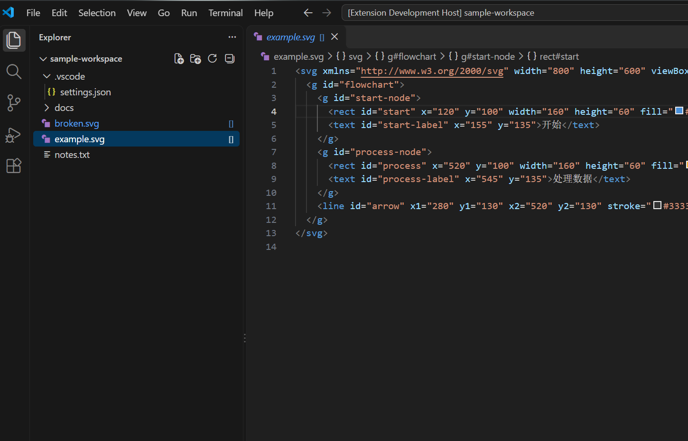

# PJ1 Phase 2：插件实践与插件式重构

> 代码仓库：<https://github.com/1745145831-ops/svg-cli-editor>。Phase 1 的最终标签是 `final`（不得移动）；Phase 2 的最终标签是 `p2`，指向本报告、代码、测试与生成指标的收尾提交。

本阶段完成两部分：

1. 一个真正可运行的 VS Code 扩展：Explorer 中给 `.svg` 文件加 `[]` 装饰，原生 Outline 中展示 SVG 元素层级并支持源码定位。
2. 把 Phase 1 CLI 重构为**四个扩展点**的插件式框架：`ShapeProvider`、`Command`、`TreeDecorator`、`AttributeHandler`；原有六种图形、命令与行为保持不变，并新增 `stats`、`dir`、`box` 与两个树标签。




---

## 0. 快速开始

要求 Node.js 20+。

```bash
npm install
npm run build:cli          # 编译 CLI 到 dist/
npm run cli                # 源码模式：方式 A，默认装配四个可选插件
npm start                  # 编译产物模式：方式 A
npm start -- --config plugins.config.json   # 方式 B：配置装配
npm test                   # 104 个测试
npm run check              # 类型检查 + 依赖规则 + 测试 + 扩展打包
```

`npm run cli` / `npm start` 的默认装配会启用本阶段的四个可选插件（`stats`、`dir`、`box`、`modified-star`）。要复现 Phase 1 基线，使用空配置：

```bash
node dist/cli/main.js --config plugins.phase1.json < doc/transcript/cli-1.txt
```

VS Code 扩展的开发运行方式：

```bash
npm run build:vscode
code --extensionDevelopmentPath=<repo>/vscode-extension <repo>/vscode-extension/sample-workspace
```

打开 `sample-workspace/example.svg` 的文本编辑器（示例工作区已把它关联到默认文本编辑器），打开 Explorer 和 Outline；`notes.txt`、目录不会显示 `[]`。扩展源码在 [`vscode-extension/`](../vscode-extension/)。

---

## 1. 第一部分：VS Code 插件实践

### 1.1 文件标记

实现在 [`vscode-extension/src/svgBadgeProvider.ts`](../vscode-extension/src/svgBadgeProvider.ts)：

- `SvgBadgeProvider` 实现 VS Code 的 `FileDecorationProvider`；
- 先用 `isSvgFileUri`（[`svgFile.ts`](../vscode-extension/src/svgFile.ts)）判断本地 `file:` URI 且路径以 `.svg` 结尾；
- 再用 `workspace.fs.stat` 确认它是普通文件，因此目录即使名字以 `.svg` 结尾也不会被标记；
- 返回 `FileDecoration { badge: "[]", tooltip, color }`，不重命名、不写文件、不改变 URI。

实测截图见 [`images/vscode-svg-badge.png`](images/vscode-svg-badge.png)：`broken.svg`、`example.svg` 显示 `[]`，`notes.txt` 和 `docs/` 没有。

### 1.2 原生大纲

- [`outlineParser.ts`](../vscode-extension/src/outlineParser.ts) 是一个带源码偏移、容错的轻量 XML 轮廓解析器：记录元素的 `start/nameStart/nameEnd/end`，跳过注释、CDATA、处理指令，自闭合和未闭合标签都能安全处理。
- [`svgOutlineProvider.ts`](../vscode-extension/src/svgOutlineProvider.ts) 实现 `DocumentSymbolProvider`，把解析结果转换为 `DocumentSymbol`：
  - `name` 为 `tag#id`，没有 id 时仅为 `tag`；
  - `range` 覆盖整个元素，`selectionRange` 精确落在开始标签的标签名上，因此点击大纲节点会跳到源码；
  - 子元素递归挂到父 `DocumentSymbol.children`。
- 注册发生在 [`extension.ts`](../vscode-extension/src/extension.ts)：`activate()` 通过 `window.registerFileDecorationProvider` 和 `languages.registerDocumentSymbolProvider` 交给 VS Code；之后 VS Code 在需要时调用 provider，编辑后自动重新请求符号（无需扩展自己监听文本变化）。

截图 [`images/vscode-svg-outline.png`](images/vscode-svg-outline.png) 中，选中 `rect#start` 后定位到第 4 行；`text#start-label` 等无 id 节点只显示 `text`（示例 SVG 本身有 id 时显示 `text#id`）。

测试覆盖（[`tests/vscode/outline-parser.test.ts`](../tests/vscode/outline-parser.test.ts)，7 个用例）：嵌套分组、无 id、编辑后层级更新、未完成 XML、错误闭合、注释中的伪标签、`>` 出现在属性值内、`.svg` 文件判定。

### 1.3 VS Code 与插件的职责，以及注册/调用过程

| 角色 | 职责 |
|---|---|
| VS Code | 加载扩展宿主；根据 `activationEvents` 调用 `activate`；保存注册的 provider；渲染文件树/装饰/Outline；处理点击、源码定位、编辑事件与刷新；管理扩展生命周期 |
| 扩展 | 只负责“判断与转换”：URI 是否 SVG 文件、给出装饰元数据；文本是否为可展示的 SVG 轮廓、转换为 `DocumentSymbol`；调用 VS Code 的注册 API |
| 文件系统/文本模型 | VS Code 持有文件和 `TextDocument`；扩展只读，不修改文件内容 |

调用链：

```text
VS Code 启动 / onStartupFinished
  -> 扩展宿主加载 dist/extension.js
  -> activate(context)
  -> registerFileDecorationProvider(new SvgBadgeProvider())
  -> registerDocumentSymbolProvider({language: xml, pattern: **/*.svg}, new SvgOutlineProvider())
  -> VS Code 需要装饰时调用 provideFileDecoration(uri)
  -> VS Code 需要大纲时调用 provideDocumentSymbols(document)
  -> VS Code 渲染 badge / DocumentSymbol 树；点击节点使用 selectionRange 定位
```

### 1.4 文件装饰与经典 Decorator、Adapter 的关系

**和 GoF Decorator 的相同点**：都不修改被装饰对象本身，而是在其外部“附加”信息；文件内容/URI 不变，只在 Explorer 视图上增加 badge。**关键差异**：

- 经典 Decorator 是对象结构模式：装饰器实现同一接口、持有被装饰对象、把调用转发给它，可以递归组合（`new Border(new Scroll(new Text()))`）。
- 这里的 `FileDecoration` 是**展示层元数据**，不是包装对象；没有对 `Uri`/文件对象进行委托调用，也没有装饰器链。VS Code 自己持有文件模型并负责显示，扩展提供的是“查询函数”而不是“包装器”。
- 因此把 `SvgBadgeProvider` 称为 **Provider/Callback 扩展点 + 展示增强**更准确；它借用的是 Decorator 的“不修改原对象、附加表现”的意图，而不是其对象组合结构。

**和 Adapter 的相同点/差异**：`SvgBadgeProvider` 确实是 VS Code 的 `FileDecorationProvider` 接口的适配器，`SvgOutlineProvider` 也是把“我们的轮廓节点树”适配成 `DocumentSymbol`。但 Adapter 的目标是**接口转换**（让已有对象能被客户端使用），而这里还包含了“从 URI/文本文档生成新数据”的职责；所以是“适配器 + 转换器”，不是纯粹的类适配器。Object Adapter 的组合/委托关系对应 `SvgOutlineProvider` 内部组合 `SvgOutlineParser`（组合而非继承）。

### 1.5 Phase 1 解析、模型和遍历代码的复用评估

**可复用性结论：CLI 的 XML 读取与 Shape 模型不能直接用于编辑器实时的 Outline；复用价值主要在格式与规则层，而不是对象层。**

| Phase 1 代码 | 能否复用 | 原因 |
|---|---|---|
| `SvgDocumentReader` / `ShapeFactory` | 否 | 依赖 Node `fs`、一次性整文件读取、遇到不完整 XML 或未知元素会抛错；其主要产物是去掉了源码位置的领域 `Shape` 树 |
| `Shape`/`GroupShape` 模型 | 部分 | 可复用类型名、id、容器/叶子概念；但 `Shape` 不保存 `TextDocument` 偏移，不能用于 Outline 的定位；强依赖 DOM 包装器也不适合编辑器增量场景 |
| `LineTokenizer` | 否 | 处理 REPL 双引号，不是 XML 语法 |
| `NumberFormat`/`SvgLength` | 理论上可复用 | 但 VS Code 扩展只显示标签与层级，不需要解析几何值；为它引入 CLI 构建产物/依赖不划算 |
| 遍历思路 | 是（概念） | 深度优先、保留文档顺序的思路被 Outline 解析器和渲染器复用；实现按 VS Code 的 position/range 重新写 |

因此扩展采用了独立的、带位置且容错的解析器；这是有意接受少量重复，换取编辑器实时性、无 Node 文件系统依赖和更小的扩展包。

### 1.6 扩展证据与异常输入

- 单元测试：`npx vitest run tests/vscode`
- 异常输入：`sample-workspace/broken.svg` 故意缺少闭合标签；解析器返回已完成的祖先并标记 `malformed`，不会抛异常，Outline 暂时显示部分层级。
- 截图：`images/vscode-svg-badge.png`、`images/vscode-svg-outline.png`。

---

## 2. 第二部分：CLI 插件式重构

### 2.1 总体结构

```text
src/
  kernel/                 扩展点接口、注册表、事务激活、端口、命令上下文
  domain/                 图形模型、组合树、命令对象、Memento、长度归一化
  application/            解析、分发、会话、内置 handler、显示
  infrastructure/         SVG 读写适配器、目录访问适配器
  plugins/
    builtin-shapes/       六种 Phase 1 图形的 ShapeProvider
    builtin-commands/     Phase 1 的 20 条内置命令
    stats/                stats 命令插件
    dir/                  dir 命令插件（只依赖 DirectoryAccess）
    shape-box/            box 图形 + 属性处理器 + (box) 标签
    tree-star/            modified-star 标签
  host/                   组合根、代码装配、配置装配加载器
  cli/                    入口与终端适配器
plugins/                  配置装配使用的薄 package（package.json + dist 转发）
vscode-extension/         独立的 VS Code 扩展
```

`kernel` 只依赖 `domain`/`shared`；`application`/`infrastructure` 依赖 kernel 端口；可选插件只依赖 kernel/domain，不 import host/loader；`host` 是唯一同时知道实现与装配的地方。

### 2.2 扩展点清单

四个接口都在 **kernel 侧**，内核只按接口工作，不枚举具体名称。

#### （1）`ShapeProvider`

| 项 | 内容 |
|---|---|
| 接口 | [`src/kernel/plugin/ShapeProvider.ts`](../src/kernel/plugin/ShapeProvider.ts) |
| 职责 | 一种图形类型的 CLI 创建与 SVG 导入；描述 tag、是否容器、SVG 匹配规则、帮助行 |
| 注册表/调用 | [`ShapeRegistry`](../src/kernel/plugin/ShapeRegistry.ts)：`createFromCli()`、`resolveSvg()`、`createFromSvg()`、`isSupportedSvgTag()`、`isContainerTag()` |
| 内核调用位置 | `CreateCommandHandler.execute`（[`CreateCommandHandler.ts`](../src/application/handlers/CreateCommandHandler.ts)）与 `SvgDocumentReader.convertElement`（[`SvgDocumentReader.ts`](../src/infrastructure/svg/SvgDocumentReader.ts)） |
| 已有实现 | `BuiltinShapesPlugin` 的 6 个 provider（rect/circle/ellipse/line/text/g）；`BoxShapeProvider` |
| 禁用可选插件时 | 仍默认注册六种内置图形；`create box` → `error: unknown shape type: box (is the plugin loaded?)`；读取 `data-kind="box"` 时由低优先级 `g` provider 读成普通组 |
| 契约违反 | 未注册类型由 registry 抛 `Unknown shape type`；provider 在 CLI 创建中抛错时命令失败、`EditCommand` 恢复 before 快照、历史不增加；读取中抛错被 reader 包装为 `cannot parse SVG: ...` 且不替换当前文档；注册名重复 → `duplicate registration: shapes/<name>` |

#### （2）`Command`

| 项 | 内容 |
|---|---|
| 接口 | [`src/kernel/plugin/Command.ts`](../src/kernel/plugin/Command.ts) |
| 职责 | 一条 REPL 命令的名称、别名、usage/summary、执行逻辑；命令自己负责参数规则与帮助元数据 |
| 注册表/调用 | [`CommandRegistry`](../src/kernel/plugin/CommandRegistry.ts) `execute()`；[`CommandDispatcher`](../src/application/CommandDispatcher.ts) `dispatch()`；[`CliApplication.handleLine`](../src/cli/CliApplication.ts) |
| 内核调用位置 | `CliApplication.handleLine` → `CommandDispatcher.dispatch` → `CommandRegistry.execute` |
| 已有实现 | `BuiltinCommandPlugin`（20 条 Phase 1 命令）；`StatsCommand`；`DirCommand` |
| 禁用可选插件时 | 只保留 Phase 1 命令表；执行 `stats`/`dir` → `error: unknown command: stats (type 'help')`；`help` 与 Phase 1 逐字节一致 |
| 契约违反 | 未知命令 → `unknown command: <name> (type 'help')`；名称/别名重复 → `duplicate registration: commands/<name>`；命令抛错由 `CliApplication` 统一格式化为 `error:`，不使进程退出 |

#### （3）`TreeDecorator`

| 项 | 内容 |
|---|---|
| 接口 | [`src/kernel/plugin/TreeDecorator.ts`](../src/kernel/plugin/TreeDecorator.ts) |
| 职责 | 为 `tree` 的某一行返回行尾标签；可持有自己的状态 |
| 注册表/调用 | [`TreeDecoratorRegistry`](../src/kernel/plugin/TreeDecoratorRegistry.ts) `decorationsFor(row)` |
| 内核调用位置 | [`TreeRenderer.withLabels`](../src/application/display/TreeRenderer.ts)（根行与每个子行） |
| 已有实现 | `BoxTypeDecorator`（`(box)`）；`ModifiedStarDecorator`（`modified-star`） |
| 禁用可选插件时 | 无 decorator，`tree` 输出与 Phase 1 逐字节一致（见 `tests/integration/display.test.ts` 与兼容性 transcript） |
| 契约违反 | 名称重复 → `duplicate registration: decorators/<name>`；单个 decorator 抛错会作为命令内部错误显示，不影响下一次命令 |

#### （4）`AttributeHandler`

| 项 | 内容 |
|---|---|
| 接口 | [`src/kernel/plugin/AttributeHandler.ts`](../src/kernel/plugin/AttributeHandler.ts) |
| 职责 | 定义“某图形上的某属性”的领域语义；`handles` 必须是纯判断，`apply` 执行修改 |
| 注册表/调用 | [`AttributeRegistry`](../src/kernel/plugin/AttributeRegistry.ts) `apply(document, shape, attr, value)` |
| 内核调用位置 | `SetCommandHandler.execute` 构造 `SetAttributeCommand` 时注入 override（[`SetCommandHandler.ts`](../src/application/handlers/SetCommandHandler.ts)）；实际调用在 [`SetAttributeCommand.apply`](../src/domain/command/SetAttributeCommand.ts) |
| 已有实现 | `BoxAttributeHandler`（box 的 `fill` → 内部 rect，`label` → 内部 text） |
| 禁用可选插件时 | 没有处理器命中，回退 Phase 1 白名单：`Shape.setAttribute`；普通矩形的 `fill` 照常可改，未定义属性 → `error: unknown attribute: <attr>` |
| 契约违反 | 同名重复 → `duplicate registration: attributes/<name>`；同优先级多命中 → `ambiguous attribute handlers for <id>/<attr>: ...`；处理器抛错时**不**回退默认逻辑，`EditCommand` 恢复 before 快照，历史不变 |

### 2.3 重构前后的模块依赖图（PlantUML）

重构前（Phase 1，保留原图）：


源文件：[`architecture.puml`](architecture.puml)。

重构后：


源文件：[`architecture-phase2.puml`](architecture-phase2.puml)。生成命令：

```bash
java -jar plantuml.jar -tpng doc/architecture-phase2.puml
```

依赖方向要点：

- kernel 只定义接口/注册表/端口，不 import 任何插件或 host 装配；
- 六个内置图形、内置命令也被做成插件，通过同一条 `PluginRuntime.activate` 路径注册，默认装配只是“注册了这些内置插件”；
- 可选插件只依赖 kernel 的公开接口、domain 和 shared，不依赖 loader/host；
- host 负责实例化与注入，是唯一知道基础设施和具体插件的地方；
- `dir` 的 `DirectoryAccess` 与 SVG 的 `SvgDocumentGateway` 都是 kernel 端口，infrastructure 提供适配器。

### 2.4 重构前的两个名称分派点如何消失

Phase 1 的 `ShapeFactory`（`switch(type/tag)`）和 `CommandDispatcher`（命令名到 handler 的 Map 构造）被替换为：

- `ShapeRegistry`：按 `shapeType` 查 provider，按 tag + provider 匹配规则解析 SVG；
- `CommandRegistry`：按命令名/别名查 `Command`。

内核没有 `if (type === "box")`、`if (command === "stats")` 这类分支；新增 `box`/`stats`/`dir` 或未来的 `diamond` 不需要改这两个注册表。

---

## 3. 两种装配方式

### 3.1 方式 A：改代码（组合根）

[`CodeAssembly.ts`](../src/host/CodeAssembly.ts) 是唯一的代码装配文件：

```ts
export const codeAssembly: readonly Plugin[] = [
  statsPlugin,
  dirPlugin,
  boxPlugin,
  treeStarPlugin
];
```

`main.ts` 在无 `--config` 时依次 `host.activate(plugin)`；每个插件仍走 `PluginRuntime.activate` 的**同一套暂存、manifest 校验、重复检查、提交**流程。新增插件时只需 import 实例并追加一行（以及必要的插件包本身）。

### 3.2 方式 B：改配置

仓库根 [`plugins.config.json`](../plugins.config.json)：

```json
{
  "plugins": [
    { "module": "./plugins/stats" },
    { "module": "./plugins/dir" },
    { "module": "./plugins/shape-box" },
    { "module": "./plugins/tree-star" }
  ]
}
```

结构：

```json
{
  "plugins": [
    { "module": "<specifier>", "options": { "fill": "#f5a623" }, "enabled": false }
  ]
}
```

- `module` 必填；相对路径**以配置文件所在目录为基准**解析（`createRequire(join(baseDir, "__plugin_config__.js")).resolve`）；包名按运行环境 Node 模块解析规则解析。
- `enabled: false` 完全跳过，不 import、不解析模块。
- `options` 必须是 JSON 对象，在 `activate` 之前传给可选的 `plugin.configure(options)`；插件可在配置里传颜色等参数。
- 每个插件包的 `package.json` 用 `contributes` 声明四类贡献；loader 将其作为**声明值**，与插件激活时实际注册的集合逐类比较。
- `plugins/*/index.js` 是“构建产物转发”薄层（例如 `export { default } from "../../dist/plugins/stats/index.js"`），所以配置里的模块名保持为 `./plugins/stats` 这类稳定模块名；运行配置装配前需先 `npm run build:cli`。
- loader 位于 [`src/host/loader/`](../src/host/loader)，不属于 kernel；它不包含任何具体插件导入、名称映射表或 `switch` 插件名。

`--config` 参数的入口解析在 [`src/cli/main.ts`](../src/cli/main.ts)。配置语法/结构非法、模块缺失、无默认导出、manifest 不一致、重复注册、激活抛错时，loader 返回/打印 `error:` 行并继续启动；主程序不退出。

### 3.3 失败处理与回滚

| 失败 | 输出（loader 产出文本，入口加 `error: `） | 状态 |
|---|---|---|
| 模块找不到 | `plugin not found: <module>` | 继续下一个 |
| 没有默认导出 | `plugin has no default export: <module>` | 继续 |
| `contributes` 与实际注册不一致 | `plugin manifest mismatch: <name> (declared: …; registered: …)` | 暂存贡献丢弃 |
| `activate` 抛错 | `plugin failed to activate: <name> (<reason>)` | 暂存贡献丢弃 |
| 同名注册 | `duplicate registration: <category>/<name>` | 当前插件全部暂存贡献丢弃 |
| 配置语法/结构非法 | `invalid plugin config` | 以默认内置能力启动 |

实现方式：`PluginRuntime.activate` 为每个插件创建独立的 `PluginActivationContext`，`activate` 期间只写入暂存数组；随后比较 manifest、对四类注册**先统一预检重复**，全部通过后才提交到 live registry/event bus。因此失败不会留下半个插件。

### 3.4 A/B 一致性验证

[`scripts/verify-assembly.mjs`](../scripts/verify-assembly.mjs) 在两个内容完全相同的固定临时目录中，分别以方式 A 和方式 B 执行 [`doc/transcript/cli-2.txt`](transcript/cli-2.txt)：

```bash
npm run build:cli
node scripts/verify-assembly.mjs
# A/B identical: 1693 bytes, 46 lines
```

输出分别保存在 [`cli-2-code.txt`](transcript/cli-2-code.txt) 和 [`cli-2-config.txt`](transcript/cli-2-config.txt)，两次逐字节相同。输入只含命令/注释；日志写在目录外；`dir` 使用固定内容（`.hidden`、`docs/`、`plugins/`、`demo.svg`、`package.json`）。

Phase 1 兼容性对照：

```bash
node scripts/verify-compat.mjs
# Phase 1 compatibility identical: 1186 bytes
```

期望输出 [`cli-1-final.txt`](transcript/cli-1-final.txt) 是**从 tag `final` 的干净 worktree 构建的 Phase 1 程序**对 [`cli-1.txt`](transcript/cli-1.txt) 的输出；当前 Phase 2 通过 `--config plugins.phase1.json`（空插件列表）运行同一输入，输出保存在 [`cli-1-phase2-builtins.txt`](transcript/cli-1-phase2-builtins.txt)，逐字节一致。

`box` 接入的提交历史判据（实际提交哈希见 git log）：

```text
方式 A 提交：只新增 src/plugins/shape-box、plugins/shape-box、测试，并修改 src/host/CodeAssembly.ts
方式 B 提交：只修改 plugins.config.json
两次提交中，src/kernel、src/application、src/domain、src/infrastructure、src/shared、
src/plugins/builtin-*、src/plugins/stats、src/plugins/dir 的 diff 均为空。
```

## 4. `stats` 与 `dir` 命令插件

### 4.1 `stats`

- 插件包：[`src/plugins/stats/`](../src/plugins/stats/)；与内置命令表包完全分离。
- 深度优先遍历当前子节点；叶子按 `typeName` 首次出现顺序计数；`g`/`box` 只计 containers，根 SVG 不计；空文档 `(total 0, containers 0)`。
- 只读，不 `executeEdit`，不进入 undo 栈。
- 测试：[`tests/plugins/stats.test.ts`](../tests/plugins/stats.test.ts)；包含空画布、嵌套分组、box 容器、只读与 help。

### 4.2 `dir` 与适配器模式

```text
DirCommand（Client）
  依赖
DirectoryAccess（Target 接口，src/kernel/ports/DirectoryAccess.ts）
  ↑ 实现
NodeDirectoryAccess（Adapter，src/infrastructure/fs/NodeDirectoryAccess.ts）
  组合
Node fs.readdirSync（Adaptee）
```

- `DirCommand` 只负责参数检查、把 `DirectoryEntry[]` 分成目录/文件/特殊项、稳定排序和格式化，不 import `fs`。
- `NodeDirectoryAccess` 把 `Dirent` 适配为 `DirectoryEntry`，把读取异常适配为 `cannot read directory: <path>`。
- 测试中 `FakeDirectoryAccess` 是 Test Double，可覆盖混合目录、隐藏项、空目录、读取失败；真实适配器测试使用临时目录。
- 特殊项（符号链接等）显示 `[OTHER]`；不递归、不遍历链接目标。`.`/`..` 不由 `readdir` 返回，因此不会出现。
- `dir` 不要求文档，不修改文档/undo；执行后仍可 `undo` 上一条编辑。

验收测试：[`tests/plugins/dir.test.ts`](../tests/plugins/dir.test.ts)。

---

## 5. `box` 图形插件

源码：[`src/plugins/shape-box/`](../src/plugins/shape-box/)。

- `BoxShape extends GroupShape`，容器语义、递归 move/scale、Composite 遍历、id 索引全部复用 Phase 1；
- 构造派生 `id-rect` / `id-label` 两个必需子部件；文本相对偏移 `(+20,+35)`；
- `data-kind="box"` 只写在 `<g>` 上；
- `BoxShape.setFill` / `setLabel` 是公开领域操作，`BoxAttributeHandler` 不直接碰私有字段；
- `cloneShape` 被重写为返回 `BoxShape`，否则 Memento 恢复会把 box 变成普通 group（这是实现中被测试抓到并修正的问题）；
- `allowsUngroup = false`；内部子部件的 `lockStructure()` 让 `SvgDocument.remove/move` 拒绝直接删除/移走；
- 创建时 `SvgDocument.attach` 对整棵新子树做 id 检查；`n1-rect` 冲突时整条命令失败，不留容器；
- 读回：安装插件时要求恰好一个 `rect` 和一个 `text` 且 id 符合派生规则，否则**拒绝整个读入**，不生成不完整 box；未安装插件时由 `g` provider 正常降级，`data-kind` 作为保留属性 round-trip；
- `(box)` 由 `BoxTypeDecorator` 提供，不依赖 `modified-star`。

测试：[`tests/plugins/box.test.ts`](../tests/plugins/box.test.ts)（13 个用例）。覆盖 CLI 创建、嵌套、in 子句、整体 move/scale、ungroup 拒绝、必需子部件删除/移动拒绝、子树 id 冲突、读写 round-trip、无插件降级、缺部件/错 id 拒绝、handler 部分修改后抛错回滚、同优先级冲突、stats 计数、Memento 恢复。

---

## 6. 树标签：`modified-star` 与 `(box)`

- `BoxTypeDecorator`：box 行返回 `(box)`。
- `ModifiedStarDecorator`：`decorate` 返回 `*`；状态全部是实例字段，没有模块级变量；订阅 `DocumentEventBus` 的 `loaded`/`saved` 事件维护基线。
- 新增标签不需要改 kernel 或 renderer；`TreeRenderer` 通过 `TreeDecoratorRegistry` 遍历标签，按注册顺序以空格拼接。
- 两个标签并存：先注册 box 时行尾为 `(box) *`，与测试/ADR 一致。

CLI 中的并存效果：

```text
svg (800x600) *
└── g#n1 (box) *
    ├── rect#n1-rect   x=520 y=100 w=160 h=60 fill=#f5a623 *
    └── text#n1-label  (540,135) "处理数据 v2" *
```

（完整运行输出见 `doc/transcript/cli-2-code.txt` 第 25-32 行；VS Code 大纲截图见 `images/vscode-svg-outline.png`，两者是不同视图。）

测试：[`tests/plugins/tree-star.test.ts`](../tests/plugins/tree-star.test.ts)（6 个用例）。

---

## 7. ADR

### ADR-001：属性处理器的对象请求与优先级冲突规则

**背景**：初始接口只有 `handles(shapeId, attr)` / `apply(shapeId, attr, value)`，没有说明处理器怎样拿到目标图形、多个处理器如何协作、如何参加 undo/失败回滚。

**决策**：

- 请求改为 `AttributeRequest { document, shape, attribute, value }`；处理器只能通过 `Shape` 的公开方法修改形状；需要子部件语义时由插件图形类公开 `setFill/setLabel` 等领域方法，字段仍封装。
- 多个命中时按 `priority` 降序选择；相同最高优先级视为冲突并抛 `ambiguous attribute handlers...`，不做隐式注册顺序覆盖。
- `SetAttributeCommand` 已经继承 `EditCommand` 的 Memento 模板：整个 `set` 是一个 undo 单元；处理器在 `apply()` 内抛错时 `EditCommand` 恢复 before 快照，`EditorSession` 不记录命令，所以历史不变；处理器错误**不会**回退到默认白名单逻辑。

**备选**：处理链组合（每个处理器都执行）会带来顺序和冲突语义；服务定位器（处理器自己 `session` 查找）会扩大权限。二者均未采用。

**代码**：`src/kernel/plugin/AttributeHandler.ts`、`AttributeRegistry.ts`、`src/domain/command/SetAttributeCommand.ts`、`src/plugins/shape-box/BoxAttributeHandler.ts`。

### ADR-002：box 读回降级与不变量

**决策**：

- **未安装 box 插件**：`<g data-kind="box">` 由普通 `GroupShapeProvider` 读成 group，保留 `data-kind`，保证文件 round-trip；这是“降级”。
- **已安装但结构不完整/子部件类型错误/id 不符合派生规则**：拒绝整个读入（reader 抛错），当前文档保持不变；不构造半成品 box。
- 重复 id 在 `SvgDocumentReader.assignIds` 阶段即拒绝，不能靠降级消除。
- 已构造的 box 通过 `lockStructure()` 锁定两个必需子部件，普通 `delete`/`addto`/`group` 会被 `SvgDocument.remove/move` 拒绝；`ungroup` 通过 `allowsUngroup = false` 拒绝。

**理由**：不完整 box 会让后续所有 box 语义（fill/label、move/scale）进入未定义状态；拒绝读入比运行时修补更可验证。降级只在“没有插件能理解 box”时发生，此时 group 是完整、有效的 Phase 1 模型。

### ADR-003：dirty 语义、祖先传播与标签顺序

**决策**：

- `modified-star` 采用“**内容与上次成功 save/load 不一致**”语义，而不是“发生过编辑命令”。因此 `save` 后编辑、再 `undo` 回到保存点时 `*` 消失；`redo` 后重新出现。
- 新节点立即标 `*`（其 id 不在基线中）。
- **不做祖先传播**：直接修改叶子时只标叶子；容器行只在自身属性/直接子节点结构变化时标；根 `svg` 行比较整篇文档，所以只要有变化就标 `*`。这与规范提供的树示意一致（`rect... *`、根 `*`，中间 group 不标）。
- 同一行多个标签按 `TreeDecorator` 注册顺序拼接，以单个空格分隔；默认装配先注册 box 的 `(box)`，再注册 `modified-star`，因此是 `(box) *`。
- `dir` 不改变 dirty 状态；`save` 失败不会触发 `saved` 事件，基线不变。

**代码**：`src/plugins/tree-star/ModifiedStarDecorator.ts`、`src/application/display/TreeRenderer.ts`、`src/application/EditorSession.ts`（`markSaved` 仅在成功写后 emit）。

### ADR-004：manifest 校验时机与两阶段装配

**决策**：

- 插件在 `PackageManifest` 的 `contributes` 是声明值；`PluginRuntime.activate` 在**激活之后、提交之前**比较四类实际注册集合。
- 先完成所有类别的重复预检，再统一提交；任何失败都保留已成功加载的插件，只丢弃当前插件的全部暂存贡献。
- 配置装配与代码装配都走 `PluginRuntime.activate`，区别只在“谁实例化插件”：`CodeAssembly` 或 `PluginConfigLoader`。
- 配置结构非法整份配置拒绝；模块求值失败按激活失败处理，不误报为“模块找不到”。

**代码**：`src/kernel/plugin/PluginRuntime.ts`、`PluginActivationContext.ts`、`src/host/loader/PluginConfigLoader.ts`。

### ADR-005：为什么 `dir` 使用端口而不是 `fs` 直连

`dir` 是命令插件，但目录访问是外部副作用；把 `DirectoryAccess` 放在 kernel 端口、把 `NodeDirectoryAccess` 放在 infrastructure，使命令插件能在没有真实文件系统的情况下独立测试，也让代码/配置两种装配共享同一个适配器实例类型。见 ADR 与第 4.2 节。

---

## 8. 指标（由脚本生成）

指标位于 [`docs/metrics/`](../docs/metrics)：

- [`summary.md`](../docs/metrics/summary.md)：内核/装配/插件三类 LOC、文件数、圈复杂度近似值与 `final → p2` 增量；VS Code 扩展独立列。
- [`files.md`](../docs/metrics/files.md)：逐文件清单、类别、LOC、CC、导出的类与职责。
- [`metrics.json`](../docs/metrics/metrics.json)：机器可读原始数据。

生成脚本 [`scripts/metrics.mjs`](../scripts/metrics.mjs) 从 git 对象读取文件，不使用工作区或手填数字：

```bash
node scripts/metrics.mjs --base final --head HEAD
```

当前生成的汇总（完整表格见 `summary.md`）：

| 类别 | final LOC | p2 源码 LOC | Δ LOC | final CC | p2 CC | Δ CC |
|---|---:|---:|---:|---:|---:|---:|
| 内核 | 2662 | 3122 | +460 | 416 | 492 | +76 |
| 装配 | 97 | 346 | +249 | 15 | 81 | +66 |
| 插件 | 0 | 751 | +751 | 0 | 83 | +83 |
| **合计** | **2759** | **4219** | **+1460** | **431** | **656** | **+225** |

VS Code 扩展独立统计：5 个源文件、298 行、近似 CC 66，不计入上表。

报告中的目标提交是生成时源码 HEAD（af8016d）；`p2` 指向随后包含本报告与 `docs/metrics` 的收尾提交，源码文件未再变化，因此表中数字就是 p2 源码树的指标。VSCode 源码在 `vscode-extension/src`，不混入 CLI 重构增量。指标口径和近似方法写在 `summary.md` 头部。

---

## 9. 测试、验证与质量门禁

### 9.1 自动化测试（104 个）

| 测试文件 | 用例 | 覆盖 |
|---|---:|---|
| `tests/application/parser.test.ts` | 6 | 分词、引号、注释、Windows 路径、未闭合引号 |
| `tests/application/number-format.test.ts` | 4 | 数字格式化与约束 |
| `tests/domain/model.test.ts` | 7 | 多态几何、Composite、Memento、id、全类型 clone |
| `tests/integration/display.test.ts` | 3 | tree/show/help 格式与错误 |
| `tests/integration/editing.test.ts` | 11 | 全命令、in、group/ungroup、z-order、失败原子性 |
| `tests/integration/history-io.test.ts` | 12 | I/O 屏障、undo/redo、save/read 失败 |
| `tests/io/svg-io.test.ts` | 14 | 导入/导出、命名空间、单位、空白、坏输入 |
| `tests/cli/cli-application.test.ts` | 2 | banner、prompt、错误前缀、quit |
| `tests/vscode/outline-parser.test.ts` | 7 | 嵌套、无 id、编辑更新、未完成 XML、异常输入 |
| `tests/host/plugin-loader.test.ts` | 10 | 四条失败路径、重复注册回滚、invalid config、BOM、enabled、options、相对路径、求值失败 |
| `tests/plugins/stats.test.ts` | 4 | 计数顺序、空画布、无 undo、help |
| `tests/plugins/dir.test.ts` | 5 | 替身/真实适配器、排序、隐藏项、空目录、读取失败、无文档、help |
| `tests/plugins/box.test.ts` | 13 | 创建、嵌套、属性、undo、不变量、读写、降级、异常、handler 冲突/回滚 |
| `tests/plugins/tree-star.test.ts` | 6 | 内容 dirty、undo 回保存点、祖先策略、失败 save、与 `(box)` 并存、实例隔离 |

当前全量覆盖率（`npm run test:coverage`，v8）：All files 88.71% statements、73.31% branches、93.41% functions、88.62% lines。

运行：

```bash
npm test
npm run test:coverage
npm run check
```

### 9.2 兼容性与双装配

```bash
npm run build:cli
node scripts/verify-compat.mjs   # 1186 bytes identical
node scripts/verify-assembly.mjs # 1693 bytes identical
```

### 9.3 手工/截图证据

- VS Code 文件标记：`images/vscode-svg-badge.png`
- VS Code 大纲定位：`images/vscode-svg-outline.png`（`rect#start` → 第 4 行）
- CLI 的 tree/stats/dir/box 输出：`transcript/cli-2-code.txt`
- 同一输入配置装配：`transcript/cli-2-config.txt`（与上文件逐字节相同）
- Phase 1 对照：`transcript/cli-1-final.txt` / `transcript/cli-1-phase2-builtins.txt`
- 所有测试输出以 `npm test` 为准，不把终端提示符写进输入 session。

### 9.4 质量门禁

```bash
npm run typecheck
npm run check:arch
npm test
npm run build:cli
npm run build:vscode
npm run verify:compat
npm run verify:assembly
```

---

## 10. 与 AI 协作时的检查与修正

本项目按“AI 生成候选 → 对照规范人工审查 → 运行验证 → 修正并留下测试”推进。下面记录的是实际发生、能对应到代码/测试的检查点，而不是“最后能跑”。

| 轮次 | AI 建议/初稿 | 检查发现 | 修正与证据 |
|---|---|---|---|
| 1 | 把所有扩展点做成“一个大 PluginManager”，插件直接访问 session/host | 会让插件依赖宿主内部、破坏内核只依赖接口 | 引入 kernel `PluginContext` 暂存注册、kernel 端口；host 只做注入；`check-architecture.mjs` 禁止 plugins→host |
| 2 | `AttributeHandler` 只接 `shapeId`，内部再查 document | 处理器需要重复查找，且无法在 `handles` 阶段拿到类型/子部件；失败回滚边界不清 | 改为 `AttributeRequest`，把 handler 放在 `SetAttributeCommand` 的 Memento 事务内；失败回滚测试 `box.test.ts` |
| 3 | 多个 handler 命中时“按注册顺序执行” | 规范要求明确冲突/组合规则；静默覆盖不可接受 | ADR 选择 priority + 同优先级拒绝；`rejects equal-priority handler conflicts` 测试 |
| 4 | box 直接 `new GroupShape` 然后塞子节点，靠 `instanceof GroupShape` 判断 | 无法在 `ungroup` 拒绝、clone 后类型丢失、子部件可被删 | 独立 `BoxShape extends GroupShape`、`cloneShape` 重写、`lockStructure`、`allowsUngroup`；box 测试覆盖 |
| 5 | 读 box 时缺子部件就“补一个空 rect”继续 | 会生成不完整对象，后续语义未定义 | 拒绝整个读入，保留原文档；ADR-002 与 malformed 读入测试 |
| 6 | tree 标签用模块级 `Set` 记录编辑 id | 规范明确要求实例字段 | `ModifiedStarDecorator` 实例字段 + 事件订阅；两实例隔离测试 |
| 7 | dirty 采用“发生过编辑命令”以便实现简单 | 规范要求明确选择；撤销回保存点的行为不同 | 选择“内容 vs 保存/加载”，补 `undo` 回保存点与失败 save 测试 |
| 8 | 配置 loader 直接 `import` 四个插件名 | 违反加载器独立性，新增插件要改 loader | 只用 `require.resolve` + 动态 `import` + package.json；`rg` 检查并人工确认无名称分支 |
| 9 | 配置读取直接 `JSON.parse(readFileSync)` | Windows/PowerShell 生成的 UTF-8 BOM 会让合法配置被误判 | loader 读取后 strip BOM；补 `accepts a UTF-8 BOM in the config file` 测试 |
| 10 | 兼容性脚本用 `git worktree` + `node_modules` junction 构建 final | 在 Windows 上删除 worktree 时可能穿透 junction 清空主依赖 | 改为对照已提交的、从 final 干净 worktree 生成的 transcript；脚本不再操作依赖目录 |

人工复核方式：逐条把规范条款映射到测试/transcript；对 AI 指出的问题先复现（或写失败测试）再接受；对“看起来合理但无规范依据”的建议（例如提前实现完整 SVG 规范、给所有图形预建抽象）不采纳。

---

## 11. 已知边界

1. VS Code 扩展只做轮廓和标记，不做 SVG 规范校验/图形预览；不完整 XML 时允许暂时显示部分轮廓或空轮廓。
2. Outline 解析器是轻量 XML 扫描器，不处理 DTD 实体、复杂命名空间语义；对编辑器大纲足够，但不是通用 XML 解析器。
3. CLI `modified-star` 的“内容”按图形自身属性/文本/直接子 id 及整篇文档比较；不解释 transform 矩阵的渲染等价。
4. `dir` 的特殊项统一显示 `[OTHER]`，不递归符号链接目标。
5. 配置装配依赖构建产物（`plugins/*/index.js` 转发 `dist/`）；源码方式 A 由 tsx 直接运行。
6. `box` 读入采用严格拒绝策略；没有插件时才会降级为普通 group。
7. 插件 handler 的错误会显示为命令错误；不会静默吞掉，也不会继续默认属性逻辑。

---

## 12. 附：常用验证命令

```bash
# CLI
npm run build:cli
node dist/cli/main.js --config plugins.config.json
node dist/cli/main.js --config plugins.phase1.json

# 测试与指标
npm run check
npm run test:coverage
node scripts/metrics.mjs --base final --head HEAD

# 兼容性/双装配
node scripts/verify-compat.mjs
node scripts/verify-assembly.mjs

# VS Code 扩展
npm run build:vscode
code --extensionDevelopmentPath=<repo>/vscode-extension <repo>/vscode-extension/sample-workspace
```
